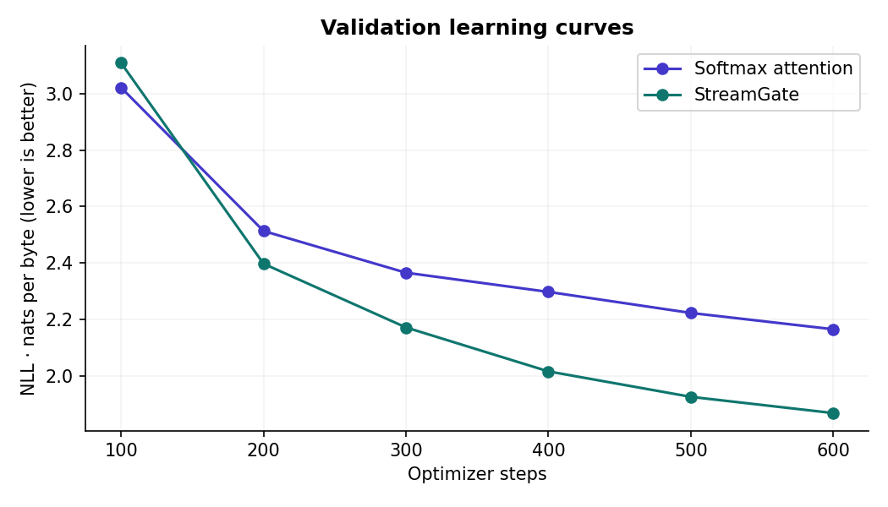
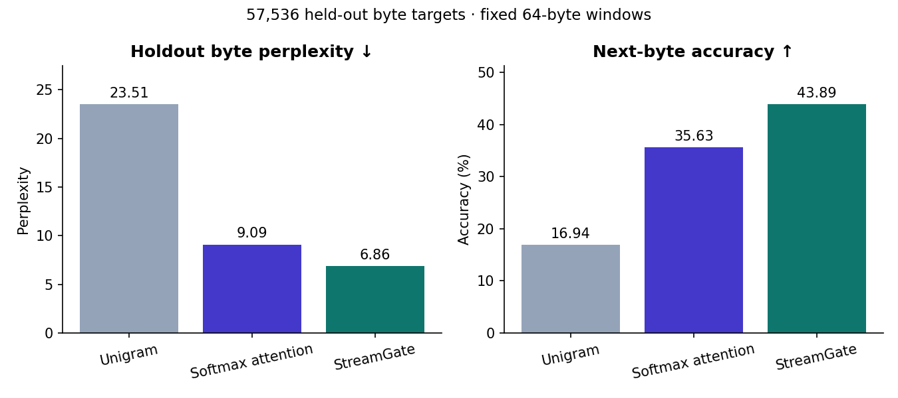
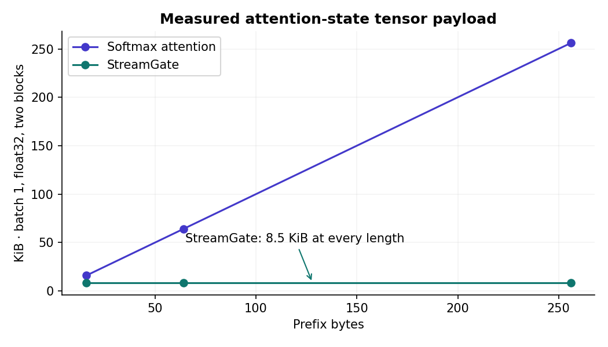
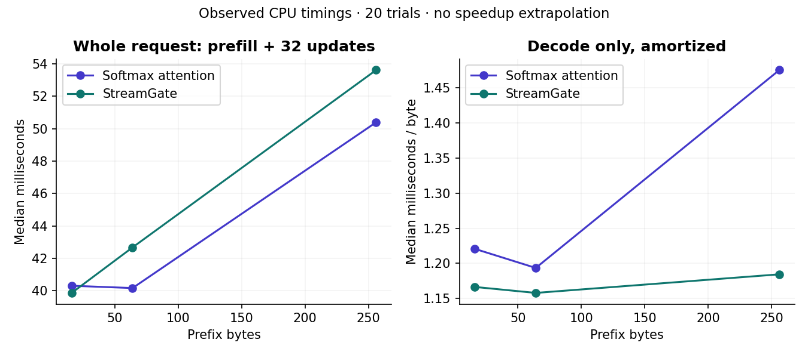
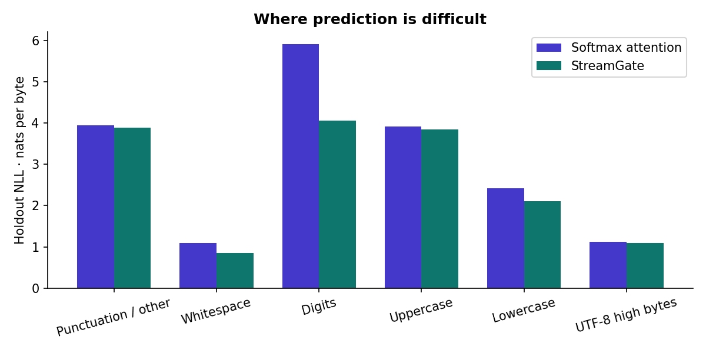
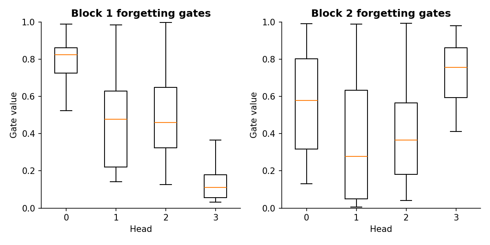

# بوابة متتابعة بحالة انتباه ثابتة

نموذج بايتات يقارن الانتباه القياسي بحالة تكرارية ثابتة الحجم وبوابة نسيان متعلّمة.

البيانات 575,793 بايتًا من «مغامرات شرلوك هولمز»، والمفردات ثابتة من 256 بايتًا. تتضمن البنيتان كتلتين وعرضًا 64 وأربعة رؤوس، مع اختلاف آلية الانتباه. أضافت البوابة 520 معاملًا.

تلقت البنيتان 614,400 هدف بايت مأخوذًا بالعينة خلال 600 خطوة، وبالبذرة 42 وحجم دفعة 16 وسياق تدريب 64. اختير النموذج على التحقق الكامل قبل تقييم 57,536 هدفًا محفوظًا.

بلغت حيرة البوابة 6.8628 مقابل 9.0866 للانتباه القياسي. حمولة الحالة 8.5 كيلوبايت ثابتة مع طول البادئة؛ وهي أقل 86.7% من حمولة القياسي عند 64 بايتًا.

ثبات حالة الاستدلال لا يعني ثبات ذاكرة التدريب؛ يحتفظ التدريب بالحالات الوسيطة للاشتقاق. لم يوجد تفوق ثابت في زمن الطلب الكامل على المعالج المركزي، وكانت تهيئة البادئات الطويلة أبطأ. حمل 256 بايتًا يقيس التوسع والتكافؤ، ولا يثبت جودة التنبؤ خارج سياق التدريب.

## النتائج المسجّلة

الأرقام التالية من التنفيذ المحفوظ لهذه النسخة؛ لم تُعَد التجارب أثناء تعريب التوثيق.

### اختيار النموذج على التحقق

| النموذج | المعاملات | الخطوة المختارة | NLL على مجموعة التحقق الكاملة ↓ | حيرة التحقق ↓ |
| :--- | ---: | ---: | ---: | ---: |
| **StreamGate** | **83,464** | **600** | **1.8876** | **6.6037** |
| الانتباه المطبّع | 82,944 | 600 | 2.1759 | 8.8097 |

### التقييم النهائي على الاختبار المحفوظ — 57,536 هدفًا من البايتات

| النموذج | الحيرة ↓ | البتات لكل بايت ↓ | دقة البايت التالي ↑ |
| :--- | ---: | ---: | ---: |
| **StreamGate** | **6.8628** | **2.7788** | **43.89%** |
| الانتباه المطبّع | 9.0866 | 3.1837 | 35.63% |
| خط أساس أحادي الرموز من التدريب فقط | 23.5051 | 4.5549 | 16.94% |

### حالة الاستدلال المتتابع وزمن المعالج المركزي

| البادئة | حالة الانتباه المطبّع | حالة البوابة المتتابعة | طلب نموذج الانتباه المطبّع | طلب نموذج البوابة المتتابعة |
| :--- | ---: | ---: | ---: | ---: |
| 16 bytes | 16 KiB | **8.5 KiB** | 40.31 ms | 39.87 ms |
| 64 bytes | 64 KiB | **8.5 KiB** | 40.17 ms | 42.67 ms |
| 256 bytes | 256 KiB | **8.5 KiB** | 50.39 ms | 53.61 ms |

## الرسوم والنتائج المرئية

الرسوم محفوظة من التنفيذ الأصلي. تعريب هذه الصفحة لا يغيّر بياناتها أو تسميات الصور داخل الملفات.

## الملفات المرجعية

- [مقاييس التقييم والنتائج](metrics.json).
- [بيانات التدقيق وبيئة التنفيذ](audit.json).
- [مرجع البيانات وبصماتها وحدود التقسيم](data/manifest.json).
- [سجل أخطاء الاختبار](error_analysis.csv).
- [دفتر شرح التحليل](analysis.ipynb).
- [تفاصيل استخدام الأداة](USAGE.md).
- [ملاحظات المراجعة البشرية](LEARNING_NOTES.md).

## المصادر والإسناد

- [مصدر 1: Katharopoulos et al., *Transformers are RNNs*](https://proceedings.mlr.press/v119/katharopoulos20a.html).
- [مصدر 2: The Adventures of Sherlock Holmes, Project Gutenberg #1661](https://www.gutenberg.org/ebooks/1661).

[المرجع التقني الإنجليزي الكامل](README.en.md) يحفظ تفاصيل النسخة الأصلية. تُترك أسماء الملفات والأوامر ومعرّفات النماذج والمقاييس بصيغتها التقنية لضمان تطابقها مع الكود.
